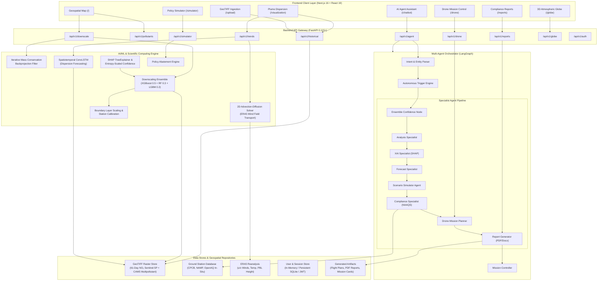

# AirQ Insight — Architecture Documentation Hub (`ARCHITECTURE.md`)

*Version: 2.1.0*  
*Primary Technical Specification: [SYSTEM_ARCHITECTURE.md](file:///Users/dhairyapunitjani/Development/My%20bharat%202026/AirQinsight/SYSTEM_ARCHITECTURE.md)*  
*Requirements Fulfilment Audit: [REQUIREMENTS_FULFILMENT.md](file:///Users/dhairyapunitjani/Development/My%20bharat%202026/AirQinsight/REQUIREMENTS_FULFILMENT.md)*  
*Sample Data & Test Verification: [SAMPLE_DATA_AND_TEST_CASES.md](file:///Users/dhairyapunitjani/Development/My%20bharat%202026/AirQinsight/SAMPLE_DATA_AND_TEST_CASES.md)*

---

## 1. Architectural Blueprint & System Summary

**AirQ Insight** is an environmental intelligence and air quality decision-support platform designed to bridge the gap between coarse satellite Earth observations (~2.5–3.5 km Sentinel-5P TROPOMI & CAMS reanalysis), atmospheric physics, in-situ ground monitoring networks (CPCB/NAMP/OpenAQ), and municipal regulatory enforcement operations.

### High-Level Topology

---

## 2. Key Architecture Subsystems

### 2.1 Physics-Preserving Downscaling Engine
- **Coarse Input:** Sentinel-5P TROPOMI Level-3 $0.035^\circ$ ($\approx 3.9\text{ km}$) satellite column rasters.
- **Ensemble Blend:** Calibrated weighted ensemble combining **XGBoost (50%)**, **Random Forest (30%)**, and **LightGBM (20%)** trained on spatial block-folds.
- **Auxiliary Predictors:** Road density raster, industrial proximity corridors, ERA5 planetary boundary layer height ($h_{\text{PBL}}$), 10m $u/v$ winds, surface temperature, and digital elevation models (DEM).
- **Physical Invariant (Iterative Backprojection):** The downscaler applies iterative backprojection to ensure that integrating the downscaled sub-pixels over any parent coarse cell strictly conserves total atmospheric column mass:
  $$\iint_{\Omega_{\text{coarse}}} C_{\text{fine}}(x,y)\,dx\,dy \equiv C_{\text{coarse}} \cdot A_{\text{coarse}} \pm 0.1\%$$

### 2.2 Atmospheric Transport & Dispersion Engine
- **Governing Equation:** Solves the 2D Advection-Diffusion Equation:
  $$\frac{\partial C}{\partial t} + u \frac{\partial C}{\partial x} + v \frac{\partial C}{\partial y} = D_x \frac{\partial^2 C}{\partial x^2} + D_y \frac{\partial^2 C}{\partial y^2} - k_{\text{decay}} C + S(x, y, t)$$
- **Meteorological Coupling:** Advection velocities $u(x,y,t)$ and $v(x,y,t)$ are fed directly from ERA5 hourly reanalysis.
- **Spatiotemporal ConvLSTM:** Neural residual predictor modeling turbulent non-linear plume evolution over 30- to 120-minute forward horizons.

### 2.3 Explainable AI (XAI) Attribution & Confidence Scoring
- **Game-Theoretic SHAP:** Employs TreeExplainer on tree ensembles to compute exact feature-level Shapley values $\phi_i(x)$:
  $$f(x) = \phi_0 + \sum_{i=1}^M \phi_i(x)$$
- **Attribution Breakdown:** Converts Shapley values into intuitive percentage contributions (Traffic, Meteorology, Industrial Stack Proximity, Biomass Burning).
- **Entropy-Scaled Confidence:** Scales attribution certainty using prediction ensemble variance and local measurement density.
- **Scientific Abstention Rule:** For secondary photochemical pollutants without precursor inventories (such as Ozone $O_3$), the engine explicitly abstains from attributing localized legal liability to prevent ungrounded enforcement actions.

### 2.4 Autonomous Multi-Agent Swarm (LangGraph)
Coordinates 8 specialist nodes in a cyclic directed graph:
1. **Mission Controller (MC):** Dispatches user intent and aggregates responses.
2. **Analysis Specialist:** Evaluates spatial distributions and identifies hotspot clusters.
3. **XAI Specialist:** Computes SHAP attributions and confidence bounds.
4. **Forecast Specialist:** Solves forward dispersion trajectories.
5. **Scenario Simulator Agent:** Runs policy counterfactuals.
6. **Compliance Specialist:** Audits CPCB National Ambient Air Quality Standards (NAAQS).
7. **Drone Mission Planner:** Computes wind-compensated aerial inspection waypoints.
8. **Report Generator:** Assembles official regulatory PDF briefs.

### 2.5 Multi-Pollutant Registry & Standards
Supports 6 key pollutants with strict physical and regulatory isolation:
- **$\text{NO}_2$:** Sentinel-5P Satellite Column ($\mu\text{mol/m}^2$) & Ground Station ($\mu\text{g/m}^3$)
- **$\text{PM}_{2.5}$:** Surface Concentration ($\mu\text{g/m}^3$) · NAAQS 24-hr: $60\,\mu\text{g/m}^3$
- **$\text{PM}_{10}$:** Surface Concentration ($\mu\text{g/m}^3$) · NAAQS 24-hr: $100\,\mu\text{g/m}^3$
- **$\text{SO}_2$:** Surface Concentration ($\mu\text{g/m}^3$) · NAAQS 24-hr: $80\,\mu\text{g/m}^3$
- **$\text{O}_3$:** Ground-level Ozone ($\mu\text{g/m}^3$) · NAAQS 8-hr: $100\,\mu\text{g/m}^3$
- **$\text{CO}$:** Carbon Monoxide ($\text{mg/m}^3$) · NAAQS 8-hr: $2.0\,\text{mg/m}^3$

---

## 3. Detailed Architecture Specifications

For the exhaustive mathematical formulations, data schemas, security architectures, and API contracts, refer to the primary architecture document:
- [👉 Read SYSTEM_ARCHITECTURE.md (470+ lines of complete architectural specifications)](file:///Users/dhairyapunitjani/Development/My%20bharat%202026/AirQinsight/SYSTEM_ARCHITECTURE.md)
