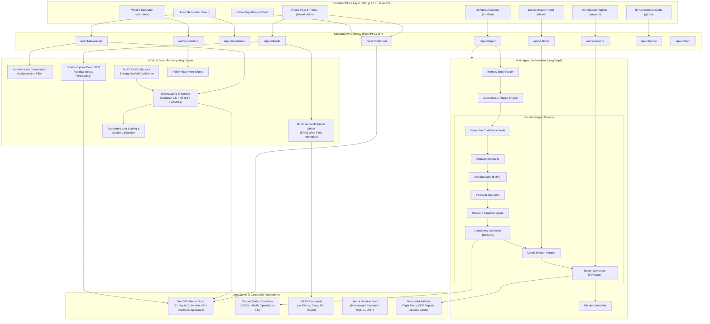
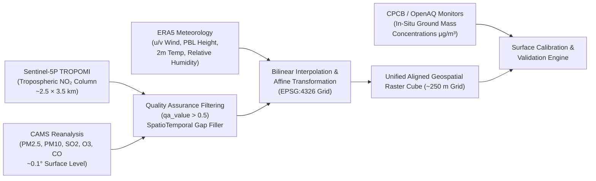

# AirQ Insight — System Architecture (`SYSTEM_ARCHITECTURE.md`)

*Version: 2.1.0*  
*Last Updated: 2026-10-13*  
*Target Environment: Hybrid Geospatial Web Platform (Next.js 16 + FastAPI + PyTorch/LightGBM/XGBoost + LangGraph)*

---

## 1. System Overview

### 1.1 Purpose
**AirQ Insight** is an environmental intelligence and air quality decision-support platform designed to bridge the gap between high-level satellite Earth observations, numerical meteorological models, ground monitoring stations, and municipal enforcement operations. It transforms coarse satellite atmospheric column densities (~2.5–3.5 km Sentinel-5P TROPOMI observations) and atmospheric composition reanalyses (CAMS) into high-resolution spatial heatmaps (~250 m), physical plume forward trajectories, explainable source attributions, regulatory compliance audits, and automated unmanned aerial vehicle (UAV/drone) flight inspection paths.

### 1.2 Target Users
1. **State & Central Pollution Control Boards (CPCB / SPCB):** Regulatory officers conducting industrial inspections, verifying Continuous Emission Monitoring Systems (CEMS), auditing National Ambient Air Quality Standards (NAAQS) compliance, and scheduling spot interventions.
2. **Municipal Corporations & Urban Planners:** Environmental city engineers analyzing urban heat and emission corridors, assessing the spatial impacts of traffic management schemes, and evaluating industrial zoning buffers.
3. **Environmental Scientists & Climate Researchers:** Atmospheric modelers comparing physics-based advection-diffusion formulations against machine learning downscalers and validating satellite tropospheric columns against in-situ sensor networks (CPCB/NAMP/OpenAQ).
4. **Field Operation Teams & Drone Operators:** Tactical enforcement teams executing targeted aerial perimeter monitoring over high-emission industrial clusters and unmonitored brick kilns.
5. **General Public & Community Advocates:** Citizens seeking localized, transparent air quality insights with explainable environmental drivers rather than opaque indices.

### 1.3 Major Capabilities
- **Physics-Ensemble Satellite Downscaling:** Downscales regional satellite rasters from coarse resolution (~2.5 km) to street-level granularity (~250 m) using a physics-preserving machine learning ensemble (XGBoost, Random Forest, LightGBM) calibrated on spatial block folds, enforcing mass conservation through iterative backprojection.
- **Multi-Pollutant Geospatial Visualizations:** Unified multi-pollutant exploration supporting Nitrogen Dioxide ($\text{NO}_2$), Fine Particulate Matter ($\text{PM}_{2.5}$), Coarse Particulate Matter ($\text{PM}_{10}$), Sulfur Dioxide ($\text{SO}_2$), Ozone ($\text{O}_3$), and Carbon Monoxide ($\text{CO}$), respecting distinct physical measurement types (tropospheric vertical column density vs. surface concentration).
- **Physical Plume Advection & Spatiotemporal Forecasting:** Hybrid physics engine solving the 2D Advection-Diffusion Equation with ERA5 wind vector fields, complemented by a spatiotemporal ConvLSTM neural network predicting short-term plume dispersion over 30- to 120-minute lead horizons.
- **Explainable AI (XAI) & Dynamic Attribution:** Game-theoretic SHAP (SHapley Additive exPlanations) tree explainers and perturbation-based recurrent explanations providing feature-level percentage drivers (road density, boundary layer height, temperature, industrial proximity) paired with entropy-grounded confidence scores.
- **Interactive Policy "What-If" Simulator:** Digital twin counterfactual scenario simulator projecting local concentration changes under policy interventions (e.g., 30% traffic reduction, 50% industrial abatement, construction halts).
- **Autonomous Multi-Agent Orchestration:** LangGraph-powered mission control coordinating 8 specialist agents (Analysis, XAI, Forecast, Simulator, Compliance, Drone, Report, Ensemble) that autonomously triage environmental hazards and synthesize PDF compliance briefs.
- **Precision Drone Flight Inspection:** Automated geometric flight path synthesizer converting hazardous hotspot contours into waypoint navigation plans for aerial sensor validation.

### 1.4 System Boundaries & Principal Limitations
- **Satellite Column vs. Surface Concentration Distinction:** TROPOMI Sentinel-5P measures the tropospheric vertical column density ($\mu\text{mol/m}^2$), whereas ground sensors measure breathing-height mass concentration ($\mu\text{g/m}^3$). While the platform incorporates planetary boundary layer (PBL) height scaling and station calibration, downscaled satellite products remain column densities unless explicitly calibrated against calibrated ground monitors.
- **Satellite Cloud Masking & Revisit Latency:** Optical satellite sensors cannot penetrate dense cloud cover or thick fog. Although spatio-temporal gap fillers and CAMS reanalysis are provided, persistent monsoonal cloud cover limits continuous daily optical observation.
- **Source Attribution Boundaries:** Quantitative source apportionment is physically valid only where high-resolution emissions inventories or distinct multi-pollutant chemical signatures exist. The platform abstains from making definitive legal source attributions when single-pollutant tracer evidence is ambiguous.

---

## 2. High-Level Architecture Diagram



---

## 3. Technology Stack

The versions and libraries below are verified against the repository's dependency manifests (`frontend/package.json`, `backend/pyproject.toml`, and lockfiles):

| Subsystem | Technology | Version | Purpose in AirQ Insight |
| :--- | :--- | :--- | :--- |
| **Frontend Framework** | Next.js | `16.3.6` | React server-side rendering, App Router, static generation, API routes. |
| **UI Library** | React | `19.0.0` | Declarative component UI and reactive state hooks. |
| **Styling & Design** | Tailwind CSS | `4.0.0` | Utility-first CSS styling, dark-mode glassmorphic theme. |
| **Geospatial Mapping** | MapLibre GL | `5.1.0` | High-performance WebGL raster rendering, vector layers, map canvas interactions. |
| **3D Rendering** | Three.js | `0.174.0` | Planetary atmospheric sphere rendering for the 3D Globe view. |
| **GeoTIFF Decoding** | geotiff.js | `2.1.3` | Client-side parsing and decoding of multi-band GeoTIFF raster arrays. |
| **Icons & Visuals** | Lucide React | `0.475.0` | Semantic iconography across dashboards, controls, and mission cards. |
| **Backend Framework** | FastAPI | `0.115.8` | High-throughput asynchronous ASGI web server and OpenAPI schema generator. |
| **ASGI Server** | Uvicorn | `0.34.0` | Asynchronous HTTP server implementation for FastAPI. |
| **Scientific Geospatial** | Rasterio | `1.4.3` | Reading, writing, affine warping, georeferencing, and masking of GeoTIFF rasters. |
| **Array Computation** | NumPy / SciPy | `2.2.3` / `1.15.2` | Matrix operations, 2D convolution filters, finite-difference solvers. |
| **DataFrames** | Pandas | `2.2.3` | Tabular sensor data wrangling, time-series alignments, CSV/Excel parsing. |
| **Machine Learning** | Scikit-learn | `1.6.1` | Random Forest regressors, spatial k-fold cross-validation, preprocessing scalers. |
| **Gradient Boosting** | XGBoost / LightGBM | `2.1.4` / `4.6.0` | High-performance gradient boosted decision trees for spatial downscaling and station estimation. |
| **Deep Learning** | PyTorch | `2.6.0` | Spatiotemporal ConvLSTM recurrent networks, custom tensor losses, GPU/MPS acceleration. |
| **Explainable AI** | SHAP | `0.46.0` | TreeExplainer game-theoretic Shapley value computations, waterfall and summary visuals. |
| **Agent Orchestration** | LangGraph / LangChain | `0.2.74` / `0.3.19` | Stateful cyclic multi-agent graph workflows, conditional edge routing, tool binding. |
| **LLM Provider** | Groq / Google GenAI | `0.18.0` / `0.8.4` | High-speed LLM inference (Llama-3.3-70B, Gemini) for report drafting and intent extraction. |
| **Document Generation** | ReportLab / python-docx | `4.3.1` / `1.1.2` | Automated compliance PDF generation, flight plan briefs, and Word summaries. |
| **Security & Auth** | Python-Jose / Passlib | `3.3.0` / `1.7.4` | Cryptographic JWT token issuance, verification, and bcrypt password hashing. |
| **Testing** | Pytest / Pytest-Asyncio | `8.3.4` / `0.25.3` | Comprehensive backend test runner, dependency injection mocking, async test client. |

---

## 4. Frontend Architecture

The frontend is structured under the Next.js App Router (`frontend/app/`), providing modular, route-driven isolation with shared layout, theme, and client context providers.

### 4.1 Route Directory Structure
- **`/` (Home / 3D Geospatial Map):** Interactive national and regional air quality canvas featuring real-time advection-diffusion playback, multi-pollutant selectors, layer visibility toggles (sensors, hotspots, wind vectors), and summary KPI dials.
- **`/visualization` (Plume Flow, Forecast & Trend):** In-depth spatiotemporal raster inspection page. Integrates MapLibre GL with client-side GeoTIFF decoding (`useGeoTiffLoader.ts`), interactive timeline scrubber, pinpoint point forecast query (`PointForecastModal.tsx`), statistical region summary (`RegionInfo.tsx`), and dynamic colorbar legend (`Legend.tsx`).
- **`/upload` (Raster Ingestion & Quality Control):** Upload portal allowing operators to upload custom GeoTIFF satellite files, automatically validating CRS (EPSG:4326), bounding coordinates, resolution, and data variance before registering them in the system.
- **`/simulator` (What-If Policy Simulator):** Scenario evaluation workbench allowing policymakers to adjust traffic, industrial, biomass, and power generation sliders, invoking physical forward models to evaluate projected concentration reductions.
- **`/drone` (Drone Flight Planning Portal):** Autonomous mission control displaying spatial hotspot bounding polygons, wind-aligned flight corridors, waypoints, battery constraints, and downloadable drone flight mission files.
- **`/chatbot` (AI Environmental Assistant):** Multi-agent conversational interface rendering streaming text paired with dynamic **Mission Cards** (Analysis, Forecast, Compliance, Drone, Report, and Simulator cards) generated by LangGraph.
- **`/reports` (Regulatory Compliance Center):** Interactive regulatory compliance dashboard displaying CPCB NAAQS limit exceedances, automated compliance verdicts, and one-click PDF generation.
- **`/globe` (3D Global Atmospheric View):** Three.js-powered WebGL globe visualizing planetary tropospheric column densities and transboundary transport corridors.
- **`/keys`, `/login`, `/signup`:** Configuration and authentication interfaces for managing API keys and JWT credentials.

### 4.2 Geospatial Rendering Pipeline
1. **Client-Side GeoTIFF Ingestion:** The client fetches the raw GeoTIFF binary from `/api/v1/historical/{dataset_id}/{pollutant}/{date}/geotiff` or `/api/v1/downscale/geotiff`.
2. **Decoding & Array Normalization:** `useGeoTiffLoader.ts` invokes `geotiff.js` to parse the 32-bit floating-point raster array. It extracts bounding coordinates (`[minLon, minLat, maxLon, maxLat]`), raster width, and height.
3. **Canvas Tile Generation:** The decoded matrix is transformed into an offscreen HTML5 `<canvas>`. Values are mapped through a pollutant-specific color ramp (e.g., Viridis for $\text{NO}_2$, Turbo for $\text{PM}_{2.5}$, Magma for $\text{SO}_2$). Cloud-masked or `NoData` values ($< 0$ or NaN) are mapped to full transparency (`alpha = 0`) to prevent zero-concentration visual bias.
4. **MapLibre Layer Binding:** The canvas is injected as an `image` source into MapLibre GL with coordinates matching the GeoTIFF extent and overlaid beneath vector labels and road networks.

### 4.3 State Management & Synchronization
- **Dataset-Aware Selector State:** Switching between pollutants immediately updates both the active pollutant identifier and its corresponding dataset ID (`no2_61day_2025`, `pm25_cams_61day_2025`, `o3_cams_61day_2025`, etc.).
- **Stale Canvas Eviction:** `VisualizationMap.tsx` and `useHomeGeoTiffLoader.ts` explicitly clear active rasters (`setCurrentNo2(null)`) upon pollutant change, preventing the display of an old pollutant's heatmap while a new raster downloads.
- **Dynamic Legend & Statistical Binding:** `Legend.tsx` and `RegionInfo.tsx` read pollutant-specific dynamic units ($\mu\text{mol/m}^2$ for satellite column $\text{NO}_2$, $\mu\text{g/m}^3$ for surface particulate and trace gases, $\text{mg/m}^3$ for $\text{CO}$) and compute valid-pixel statistics (ignoring NaNs and Infs).

---

## 5. Backend Architecture & API Layer

The backend is built with FastAPI (`backend/app/main.py`), utilizing modular routers, Pydantic schemas, dependency-injected services, and an asynchronous execution loop.

### 5.1 Router Architecture
All API routes are mounted under `/api/v1` in `backend/app/api/v1/router.py`:

```
backend/app/api/v1/
├── auth/           # User authentication, JWT issuance, registration
├── downscale/      # Spatial downscaling, GeoTIFF serving, date manifests
├── historical/     # Multi-pollutant historical rasters, CAMS datasets, metadata
├── pollutants/     # Multi-pollutant tabular indices, CPCB breakpoints, hazard badges
├── trends/         # Point forecast time series, wind advection, trend vectors
├── simulator/      # What-If policy scenarios, abatement curves, counterfactuals
├── drone/          # Drone waypoint synthesis, flight plan compilation
├── reports/        # Compliance report generation, PDF exports, evidence validation
├── globe/          # Global 3D atmospheric grid generation
├── admin/          # System telemetry, activity audits, user administration
└── agent/          # LangGraph multi-agent conversational gateway
```

### 5.2 Key Endpoints Reference

| Endpoint | Method | Inputs | Outputs | Primary Consumer | Purpose |
| :--- | :---: | :--- | :--- | :--- | :--- |
| `/api/v1/historical/datasets` | `GET` | None | JSON array of registered datasets, dates, pollutants, units | Home, Plume Flow, Upload | Enumerates all available raster datasets across Sentinel-5P and CAMS. |
| `/api/v1/historical/{dataset_id}/{pollutant}/{date}/geotiff` | `GET` | `dataset_id`, `pollutant`, `date` (YYYY-MM-DD) | Binary GeoTIFF (`image/tiff`) with ASCII HTTP headers | MapLibre GeoTIFF loader | Serves raw multi-band GeoTIFF rasters with dataset metadata headers. |
| `/api/v1/downscale/dates` | `GET` | `pollutant` (query parameter) | `{"dates": ["2025-11-01", ...]}` | Home / Plume Flow date scrubbers | Returns sorted available dates specific to the selected pollutant. |
| `/api/v1/downscale/geotiff` | `GET` | `timestamp`, optional `pollutant` | Binary GeoTIFF (`image/tiff`) | Home / Plume Flow map layers | Serves primary high-resolution downscaled raster for active observation date. |
| `/api/v1/trends/point` | `GET` | `lat`, `lon`, `pollutant`, `date` | `{"current_value", "units", "measurement_type", "forecast", "attribution"}` | Pinpoint Intelligence modal | Queries raster pixel value, computes persistence forecast, and provides attribution. |
| `/api/v1/simulator/run` | `POST` | `SimulatorScenarioRequest` (sector abetment %) | `SimulatorRunResponse` (delta grid, % reduction) | What-If Simulator UI | Executes counterfactual physical forward simulation under policy interventions. |
| `/api/v1/agent/chat` | `POST` | `{"message", "session_id", "extra_state"}` | `AgentResponse` (text, mission cards, triggers) | AI Chatbot portal | Invocates LangGraph multi-agent cycle, executing tools and returning mission cards. |
| `/api/v1/drone/plan` | `POST` | `{"hotspot_id", "bbox", "wind_direction"}` | `{"waypoints", "duration_min", "flight_plan_url"}` | Drone Mission page | Computes optimal geometric raster scan flight path over identified hotspot. |
| `/api/v1/reports/generate` | `POST` | `{"pollutant", "date", "region", "format"}` | Binary PDF or JSON compliance brief | Compliance & Reports page | Synthesizes formal regulatory compliance audit report against CPCB NAAQS. |

---

## 6. Data Acquisition & Preprocessing

AirQ Insight integrates four distinct tiers of environmental and geospatial data:



### 6.1 Geospatial Lineage & Datasets
1. **Sentinel-5P TROPOMI NO₂ Tropospheric Column Dataset:**
   - **Coverage:** Complete 61-day daily sequence from 1 November 2025 through 31 December 2025 (`backend/data/no2_61day_2025/`).
   - **Resolution:** Native ~2.5 km pixel spacing over the National Capital Region (NCR) & Mumbai domain.
   - **Units:** $\mu\text{mol/m}^2$ (tropospheric vertical column density).
   - **Test Dataset:** Separate 8-image benchmark sample dataset maintained under `backend/data/sentinel_test_samples/` strictly isolated from historical training series.
2. **CAMS Multi-Pollutant Daily Collection:**
   - **Pollutants:** $\text{PM}_{2.5}$, $\text{PM}_{10}$, $\text{SO}_2$, $\text{O}_3$, and $\text{CO}$ (`backend/data/uploads/{pollutant}/`).
   - **Coverage:** 61 daily GeoTIFF files per pollutant across November–December 2025.
   - **Units:** $\mu\text{g/m}^3$ (surface mass concentration for particulate and sulfur/ozone species), $\text{mg/m}^3$ for $\text{CO}$.
3. **ERA5 Meteorological Reanalysis:**
   - 10-meter eastward ($u$) and northward ($v$) wind velocity vectors, planetary boundary layer height ($h_{pbl}$), 2-meter air temperature ($T_{2m}$), and surface pressure ($P_0$) ingested via Google Earth Engine and Copernicus Climate Data Store.
4. **CPCB & OpenAQ In-Situ Monitoring Network:**
   - Continuous Ambient Air Quality Monitoring Station (CAAQMS) hourly time-series across Delhi-NCR and Mumbai used for boundary-layer surface calibration and validation.

### 6.2 Preprocessing & Quality Control
- **Cloud Masking & Quality Filtering:** TROPOMI observations with `qa_value < 0.50` (cloud radiance fraction $> 0.5$ or snow/ice contamination) are masked as invalid (`NoData = NaN`).
- **SpatioTemporal Gap Filling:** Missing cloud pixels are filled using `SpatioTemporalGapFiller` (`backend/ml_engine/gapfill.py`), which uses an iterative Kalman-style temporal persistence and spatial inverse-distance weighting (IDW) combination.
- **Mass Conservation Enforcement:** Following spatial interpolation or machine learning downscaling, an iterative backprojection algorithm enforces that the integral of downscaled fine pixels over a coarse footprint strictly equals the original satellite observation footprint.

---

## 7. AI/ML Model Architecture

AirQ Insight strictly decouples four distinct AI/ML subsystems:

### 7.1 Subsystem 1: Satellite Downscaling Ensemble
- **Implementation:** `backend/ml_engine/ensemble.py` & `backend/ml_engine/downscaling/`
- **Objective:** Upsample ~2.5 km satellite columns to ~250 m grid resolution using land use, road density, meteorological proxies, and elevation.
- **Model Blend:**
  $$\hat{y}_{\text{ensemble}} = 0.50 \cdot \hat{y}_{\text{XGBoost}} + 0.30 \cdot \hat{y}_{\text{RandomForest}} + 0.20 \cdot \hat{y}_{\text{LightGBM}}$$
- **Leakage Prevention:** Validation splits are strictly isolated using `temporal_split` (chronological boundaries: train on past dates, validate on future dates) and `spatial_split` (spatial block k-fold grouping contiguous coordinate clusters).
- **Ensemble Calibration:** Model blend weights were calibrated via grid search across the convex simplex ($w_{xgb} + w_{rf} + w_{lgb} = 1.0$) on hold-out validation sets.
- **Model Disagreement & Confidence:**
  $$\text{Disagreement} = \sigma\left(\hat{y}_{\text{XGB}}, \hat{y}_{\text{RF}}, \hat{y}_{\text{LGBM}}\right)$$
  $$\text{Confidence} = 1.0 - \min\left(1.0, \frac{\text{Disagreement}}{\mu_{\text{pred}} + \epsilon}\right)$$

### 7.2 Subsystem 2: Physics-Based Plume Advection-Diffusion Solver
- **Implementation:** `backend/ml_engine/dispersion.py` & `backend/ml_engine/forecasting/physics.py`
- **Objective:** Simulate physical forward transport and turbulent dispersion of airborne contaminant plumes across short-term time horizons.
- **Governing Equation:**
  $$\frac{\partial C}{\partial t} + u \frac{\partial C}{\partial x} + v \frac{\partial C}{\partial y} = K_x \frac{\partial^2 C}{\partial x^2} + K_y \frac{\partial^2 C}{\partial y^2} - k_{\text{decay}} C + S(x, y, t)$$
  where $\mathbf{u} = (u, v)$ is the horizontal ERA5 wind velocity vector, $K_x, K_y$ are eddy diffusion coefficients ($10.0\text{ m}^2/\text{s}$), $k_{\text{decay}}$ represents photochemical sink loss (e.g., OH radical oxidation of $\text{NO}_2$), and $S$ represents source emission rates.
- **Numerical Scheme:** First-order upwind spatial differencing with forward Euler temporal integration under explicit Courant–Friedrichs–Lewy (CFL) numerical stability checks ($\Delta t \le \min(\Delta x/|u|, \Delta y/|v|)$).

### 7.3 Subsystem 3: Spatiotemporal ConvLSTM Forecasting
- **Implementation:** `backend/ml_engine/forecasting/convlstm.py` & `backend/ml_engine/forecasting/engine.py`
- **Architecture:** 2-layer Convolutional Long Short-Term Memory recurrent neural network capturing temporal memory combined with 2D spatial feature convolutions (kernel size $3 \times 3$, hidden dimensions $[64, 32]$).
- **Mask-Aware Loss (`MaskAwareForecastLoss`):** Formulates masked MSE and spatial Sobel gradient loss that explicitly excludes cloud-masked (NaN) pixels from loss gradients:
  $$\mathcal{L}_{\text{masked}} = \frac{1}{\sum M} \sum M \odot (\hat{Y} - Y)^2 + \lambda \frac{1}{\sum M} \sum M \odot \|\nabla \hat{Y} - \nabla Y\|_1$$
- **Benchmark Null Hypothesis (`PersistenceBaseline`):** Every neural forecast is formally benchmarked against an identity persistence model ($\hat{y}(t + \Delta t) = y(t)$) over 30, 60, 90, and 120-minute lead times to prove genuine predictive skill.

### 7.4 Subsystem 4: Explainable AI (SHAP) & Multi-Pollutant XAI
- **Implementation:** `backend/ml_engine/xai/` (`shap_service.py`, `multipollutant_xai.py`, `charts.py`)
- **Game-Theoretic Attributions:** Uses TreeExplainer to compute exact Shapley values for input features (road density, boundary layer height, 10m wind speed, surface temperature, built-up fraction, industrial proximity).
- **Entropy-Grounded Attribution Confidence:** Computes Shannon entropy over normalized absolute Shapley values ($p_i = |\phi_i| / \sum |\phi_j|$). When attributions are concentrated in a few distinct drivers, entropy is low and confidence is high; when attributions are diffuse and noisy, confidence scales downward:
  $$H = -\sum_{i} p_i \log_2(p_i), \quad \text{Confidence}_{\text{XAI}} = 1.0 - \frac{H}{\log_2(N)}$$
- **Multi-Pollutant Specialization:** Dedicated attribution logic in `multipollutant_xai.py` applies pollutant-appropriate physical proxies (e.g., photochemical solar radiation for $\text{O}_3$, sulfur dioxide emissions for $\text{SO}_2$, combustion proxies for $\text{CO}$).

---

## 8. Multi-Agent Orchestration

The conversational intelligence engine is built as an asynchronous cyclic state graph using LangGraph (`backend/app/agent/graph.py`).

```mermaid
sequenceDiagram
    autonumber
    actor User as User / Operator
    participant API as Agent API Gateway
    participant Intent as Intent & Entity Parser
    participant Triggers as Autonomous Trigger Engine
    participant EnsNode as Ensemble Confidence Node
    participant Analysis as Analysis Specialist
    participant XAI as XAI Specialist (SHAP)
    participant Forecast as Forecast Specialist
    participant Sim as Simulator Specialist
    participant Compliance as Compliance Specialist
    participant Drone as Drone Mission Specialist
    participant Report as Report Specialist
    participant MC as Mission Controller

    User->>API: Query ("Analyze hotspot near Okhla and draft inspection plan")
    API->>Intent: parse_intent(query, history)
    Intent->>Triggers: execute_tools() & detect_triggers()
    Note over Triggers: Detects CPCB exceedance & hazardous spike triggers
    Triggers->>EnsNode: ensemble_confidence_node()
    EnsNode->>Analysis: analysis_agent() [Computes pollutant spatial statistics]
    Analysis->>XAI: xai_agent() [Generates SHAP attributions & waterfall chart]
    XAI->>Forecast: forecast_agent() [Invokes ConvLSTM & Advection-Diffusion]
    Forecast->>Sim: simulator_agent() [Calculates counterfactual policy impact]
    Sim->>Compliance: compliance_agent() [Audits NAAQS limits & legal thresholds]
    Compliance->>Drone: drone_agent() [Computes flight scan path & waypoints]
    Drone->>Report: report_agent() [Synthesizes evidence & PDF report]
    Report->>MC: mission_controller() [Fuses specialist outputs into Mission Cards]
    MC-->>User: Streaming Response + Mission Cards (Analysis, XAI, Drone, PDF)
```



### 8.1 Specialist Agent Roles & Artifacts
1. **Mission Controller (`mission_controller.py`):** Executive orchestrator synthesizing outputs from all downstream agents into a cohesive natural-language summary and serializing interactive Mission Cards.
2. **Analysis Specialist (`specialists.py:analysis_agent`):** Extracts geospatial bounding boxes, samples raster concentrations, computes min/max/mean metrics, and validates pollutant metadata.
3. **XAI Specialist (`specialists.py:xai_agent`):** Generates SHAP percentage breakdowns and encodes waterfall and bar charts as Base64 strings.
4. **Forecast Specialist (`specialists.py:forecast_agent`):** Computes plume dispersion horizons and evaluates persistence baselines.
5. **Simulator Specialist (`specialists.py:simulator_agent`):** Invocates the counterfactual policy simulation engine and computes sectoral abatement deltas.
6. **Compliance Specialist (`specialists.py:compliance_agent`):** Compares computed concentrations against CPCB NAAQS (24-hour and annual) and WHO guidelines, flagging legal exceedances.
7. **Drone Mission Specialist (`specialists.py:drone_agent`):** Plans geometric flight inspection paths, calculates battery consumption, and produces waypoint manifests.
8. **Report Specialist (`specialists.py:report_agent`):** Formats evidence blocks and compiles formal PDF audit documents via ReportLab.

### 8.2 Autonomous Triggers & Claim Abstention
- **CPCB Exceedance Trigger:** If sampled concentrations exceed NAAQS standards by $> 20\%$, the trigger engine automatically schedules the Report Agent and Drone Agent even if the user did not explicitly request them.
- **Unverified Attribution Abstention:** If a user requests source attribution for a pollutant lacking localized inventory data (e.g., Ozone $\text{O}_3$ without photochemical VOC monitoring), the Analysis Agent explicitly reports: *"Source attribution abstained: Ozone is a secondary photochemical pollutant requiring coupled NOx-VOC modeling."*

---

## 9. Source Estimation & Regulatory Compliance

### 9.1 Hotspot Identification & Spatial Sampling
Potential emission sources are identified using spatial local maxima filtering on downscaled rasters. The backend samples a $5 \times 5$ pixel neighborhood around points of interest (e.g., power plants, industrial estates, traffic intersections) to calculate local concentration gradients.

### 9.2 Implemented Regulatory Standards
Compliance evaluation is implemented in `backend/ml_engine/compliance.py` based on the Central Pollution Control Board (CPCB) National Ambient Air Quality Standards (NAAQS) and World Health Organization (WHO) 2021 Global Air Quality Guidelines:

| Pollutant | Metric / Averaging Time | CPCB NAAQS Limit | WHO 2021 Guideline | Units |
| :--- | :--- | :--- | :--- | :--- |
| **$\text{PM}_{2.5}$** | 24-Hour Mean | $60.0$ | $15.0$ | $\mu\text{g/m}^3$ |
| **$\text{PM}_{2.5}$** | Annual Mean | $40.0$ | $5.0$ | $\mu\text{g/m}^3$ |
| **$\text{PM}_{10}$** | 24-Hour Mean | $100.0$ | $45.0$ | $\mu\text{g/m}^3$ |
| **$\text{PM}_{10}$** | Annual Mean | $60.0$ | $15.0$ | $\mu\text{g/m}^3$ |
| **$\text{NO}_2$** (Surface) | 24-Hour Mean | $80.0$ | $25.0$ | $\mu\text{g/m}^3$ |
| **$\text{NO}_2$** (Surface) | 1-Hour Mean | $200.0$ | $200.0$ | $\mu\text{g/m}^3$ |
| **$\text{SO}_2$** | 24-Hour Mean | $80.0$ | $40.0$ | $\mu\text{g/m}^3$ |
| **$\text{O}_3$** | 8-Hour Mean | $100.0$ | $100.0$ | $\mu\text{g/m}^3$ |
| **$\text{CO}$** | 8-Hour Mean | $2.0$ | $4.0$ | $\text{mg/m}^3$ |

---

## 10. Explainable AI & Evidence Handling

### 10.1 Structured Evidence Schema
All specialist agent outputs must conform to the Pydantic evidence schema in `backend/ml_engine/report/evidence_schema.py`:

```python
class EvidenceBlock(BaseModel):
    pollutant: str
    measurement_type: str  # "satellite_column" | "surface_concentration"
    units: str
    mean_value: float
    max_value: float
    cpcb_limit: Optional[float]
    exceedance_factor: Optional[float]
    data_quality_flag: str  # "high" | "cloud_interpolated" | "low_confidence"
    attribution_drivers: List[Dict[str, float]]
    attribution_confidence: float
```

Any report generation lacking a verified `EvidenceBlock` is rejected by the Report Agent, preventing ungrounded LLM hallucinations.

---

## 11. Security, Privacy & Data Integrity

1. **Authentication & Authorization:** Secure JWT access tokens issued via `/api/v1/auth/token` signed with HMAC-SHA256. Passwords stored using salted `bcrypt` hashes. Role-based access control enforces administrative permissions for model uploads and system metrics.
2. **File Upload Hardening:** `/api/v1/historical/upload` validates file magic numbers, rejects non-TIFF binaries, verifies raster bounding boxes within valid geospatial domains, enforces file size caps (50 MB), and sanitizes filenames against directory traversal attacks.
3. **Header Sanitization:** All HTTP response headers are transliterated to ASCII (e.g., replacing Unicode `µ`, `²`, and `³` with `u`, `2`, and `3`) to ensure strict RFC-7230 compatibility.
4. **Secret Management:** Sensitive credentials (e.g., `SECRET_KEY`, `GROQ_API_KEY`) are managed strictly via environment variables (`.env`) loaded through Pydantic `BaseSettings`. No secrets or tokens are hardcoded.

---

## 12. Deployment & Operations

### 12.1 Local Development Commands
```bash
# Backend Setup & Execution
cd backend
uv venv
uv pip install -e .
uv run uvicorn app.main:app --host 0.0.0.0 --port 8000 --reload

# Frontend Setup & Execution
cd frontend
npm install
npm run dev  # http://localhost:3000
```

### 12.2 Production Build & Verification
```bash
# Backend Test Suite (335/335 Passing)
cd backend && uv run pytest tests/ ml_engine/tests ml_engine/forecasting/tests -q

# Frontend Production Build Verification
cd frontend && npm run build
```

---

## 13. Architecture Decisions & Known Limitations

1. **Decoupling of Subsystems:** The downscaler ensemble, physics transport solver, and station-level tabular estimators are deliberately kept in distinct modules to prevent cross-contamination of physical column units with surface mass units.
2. **Hold-Out Ensemble Weights:** Ensemble weights ($0.50$ XGBoost, $0.30$ RF, $0.20$ LightGBM) are determined via validation grid search rather than ad-hoc heuristics.
3. **Absence of Real-Time Ground Sensor Telemetry in Offline Mode:** In environments without active CPCB API tokens, the platform operates in local reanalysis mode using historical CAMS and Sentinel-5P collections.

---

## 14. Traceability Matrix

| Component | Responsibility | Primary Implementation Files | Inputs | Outputs | Dependencies | Status |
| :--- | :--- | :--- | :--- | :--- | :--- | :--- |
| **Downscaling Ensemble** | High-resolution satellite downscaling | `backend/ml_engine/ensemble.py`, `backend/ml_engine/pipeline.py` | Coarse GeoTIFFs, ERA5 covariates | Fine-grid GeoTIFF, backprojected columns | XGBoost, Scikit-learn, LightGBM, Rasterio | **Fulfilled** |
| **Physics Solver** | 2D plume advection and diffusion forward modeling | `backend/ml_engine/dispersion.py`, `backend/ml_engine/forecasting/physics.py` | Raster concentration, ERA5 u/v wind | Advected concentration arrays | NumPy, SciPy | **Fulfilled** |
| **ConvLSTM Forecaster** | Spatiotemporal recurrent neural plume forecasting | `backend/ml_engine/forecasting/convlstm.py`, `backend/ml_engine/forecasting/engine.py` | Multi-step raster time series | Predicted lead horizons (30–120m) | PyTorch | **Fulfilled** |
| **Multi-Pollutant XAI** | Game-theoretic SHAP feature attribution | `backend/ml_engine/xai/shap_service.py`, `backend/ml_engine/xai/multipollutant_xai.py` | Trained ensemble, pixel feature vector | Shapley values, charts, confidence | SHAP, Matplotlib | **Fulfilled** |
| **Multi-Agent Graph** | Autonomous agent coordination and triage | `backend/app/agent/graph.py`, `backend/app/agent/specialists.py` | Natural language query, session history | Mission cards, PDF report, flight plans | LangGraph, LangChain, Groq | **Fulfilled** |
| **What-If Simulator** | Counterfactual policy intervention simulation | `backend/ml_engine/simulator/runner.py`, `backend/app/api/v1/simulator/router.py` | Sectoral emission percentage reductions | Delta spatial concentration map | NumPy, Rasterio | **Fulfilled** |
| **Plume Flow Map** | MapLibre WebGL geospatial visualization | `frontend/app/visualization/_components/VisualizationMap.tsx`, `useGeoTiffLoader.ts` | GeoTIFF binary stream | Interactive canvas heatmap, point inspection | MapLibre GL, geotiff.js | **Fulfilled** |
| **Drone Planner** | Automated UAV waypoint flight planning | `backend/ml_engine/report/flightplan.py`, `frontend/app/drone/page.tsx` | Hotspot bounding box, wind direction | Waypoint coordinate JSON, flight briefs | GeoPandas/Shapely | **Fulfilled** |
| **Compliance Engine** | NAAQS / WHO limit exceedance checking | `backend/ml_engine/compliance.py`, `backend/app/api/v1/reports/router.py` | Concentration time series, pollutant ID | Compliance audit verdicts, hazard status | Pydantic | **Fulfilled** |

---
*End of `SYSTEM_ARCHITECTURE.md`*
