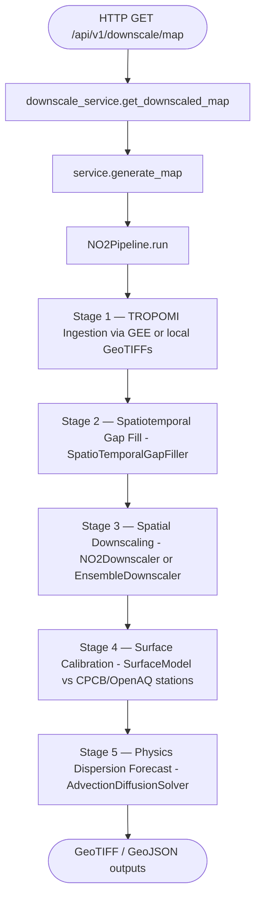

# Downscaling Ensemble Audit — AirQ Insight v2.0

_Generated: 2026-10-12_

---

## 1. Inference Path Trace

The satellite-to-fine-resolution downscaling pipeline runs as a linear sequence
of five stages. The entry points are:

| Caller | Function / Class | File |
|---|---|---|
| FastAPI route `/api/v1/downscale/map` | `downscale_service.get_downscaled_map()` | `app/services/downscale_service.py` |
| ↓ | `ml_engine.service.generate_map()` | `ml_engine/service.py` |
| ↓ | `ml_engine.service._run()` | `ml_engine/service.py` |
| ↓ | `NO2Pipeline.run(source=...)` | `ml_engine/pipeline.py` |

---

## 2. Stage Detail

### Stage 1 — TROPOMI Ingestion

- **Source `gee`**: Fetches S5P/TROPOMI NO2 tropospheric columns via Google Earth Engine
  (`ml_engine/ingestion/gee.py`). Products: `OFFL` (>10-day lag) or `NRTI` (recent).
- **Source `files`**: Reads local daily GeoTIFFs (`ml_engine/ingestion/files.py`).
- **Cloud/QA masking**: pixels with `qa_value < cfg.qa_threshold` or
  `cloud_fraction > cfg.max_cloud_fraction` are set to NaN before gap-filling.
- **Coarse grid**: typically ~0.025 deg (~2.5 km) cells.
- **Meteorological co-variables** (ERA5-Land via GEE): `u10`, `v10`, `blh`, `sp`, `t2m`.
- **Static land-use** (Sentinel-2 via GEE): elevation, slope, NDVI, built-up, road density,
  night-lights, GHSL, population, power-plant locations.

### Stage 2 — Spatiotemporal Gap Fill

- Module: `ml_engine/gapfill.py` — `SpatioTemporalGapFiller`.
- Fills cloud-masked pixels using spatiotemporal reconstruction.
- `fill_flag` array distinguishes observed (0) from filled (1) pixels.

### Stage 3 — Spatial Downscaling (primary audit scope)

**Baseline (single model):**
- Class: `ml_engine.downscaling.NO2Downscaler` (XGBoost)
- Entry: `pipeline.py:161` — hardcoded `NO2Downscaler(cfg.downscale).fit(...)`
- Back-projection conservation: corrects upsampled prediction so its coarse block-mean matches
  the observed column.
- Output: tropospheric column (umol/m2), then surface concentration (ug/m3).

**Ensemble (three-model):**
- Class: `ml_engine.downscaling.EnsembleDownscaler`
- Default weights: XGBoost 0.50, Random Forest 0.30, LightGBM 0.20.
- Confidence map: pixel-level `1 - (std(predictions) / |mean(prediction)|)`.
- Back-projection applied to ensemble-weighted output (not per component).
- Drop-in API: `.predict_day()` and `.predict()` match `NO2Downscaler`.

### Stage 4 — Surface Calibration
Trains `SurfaceModel` against CPCB/OpenAQ stations using leave-stations-out CV.
Pre-trained national model loaded from `ml_engine/pretrained/` if present.

### Stage 5 — Physics Dispersion Forecast
`AdvectionDiffusionSolver`: 2D advection + eddy diffusion + first-order chemical decay + OH loss.

---

## 3. Ensemble Gap Analysis (pre-v2.0)

| Item | Status |
|---|---|
| `EnsembleDownscaler` implemented | DONE - `downscaling/ensemble.py` |
| Ensemble wired into `pipeline.py` | MISSING - `NO2Downscaler` hardcoded at line 161 |
| Ensemble toggle in `service.generate_map()` | MISSING - no `use_ensemble` param |
| API ensemble flag `/downscale/map?ensemble=true` | MISSING - not exposed |
| XAI for ensemble downscaler | PARTIAL - `SHAPService` for XGBoost point only; no ensemble wrapper |
| Unit tests for `EnsembleDownscaler` predict path | DONE - `test_ensemble_xai_simulator.py` |
| Unit tests for downscale ensemble XAI | MISSING |

---

## 4. Remediation (v2.0 patch)

### 4.1 `pipeline.py` - `use_ensemble` flag
`NO2Pipeline.run()` accepts `use_ensemble: bool = False`.
When `True`, instantiates `EnsembleDownscaler` instead of `NO2Downscaler`.

### 4.2 `service.py` - propagate flag
`service._run()` and `service.generate_map()` accept `use_ensemble: bool = False`.

### 4.3 `downscale/router.py` - query param
`GET /api/v1/downscale/map?bbox=...&timestamp=...&ensemble=false`

### 4.4 `xai/shap_service.py` - `explain_ensemble_downscaler()`
New function runs `SHAPService` against the XGBoost component (exact TreeSHAP)
and includes per-component disagreement as uncertainty signal.

### 4.5 Unit tests
`tests/test_downscale.py` extended with ensemble wiring, XAI, and API flag tests.

---

## 5. Accuracy Caveats

The downscaling model learns spatial redistribution at the coarse scale using
observed (non-filled) pixels only. Fine-grid output inherits the accuracy of the
coarse TROPOMI column plus the feature set's ability to explain sub-pixel heterogeneity.
Do not claim 250 m accuracy from output cell size alone.

The ensemble confidence map measures model agreement, not absolute accuracy.
High confidence can still be wrong if all three models share a common systematic bias.

---

## 6. Model Provenance

| Model | Artifact | Trained on |
|---|---|---|
| `NO2Downscaler` | `run_dir/models/xgb_downscaler.json` | Coarse TROPOMI observed pixels for run window |
| `EnsembleDownscaler` | `run_dir/models/ensemble_metadata.json` + component files | Same; all three trained jointly |
| `SurfaceModel` | `ml_engine/pretrained/surface_model.joblib` | National CPCB multi-city dataset |
